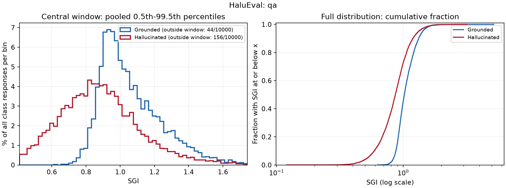
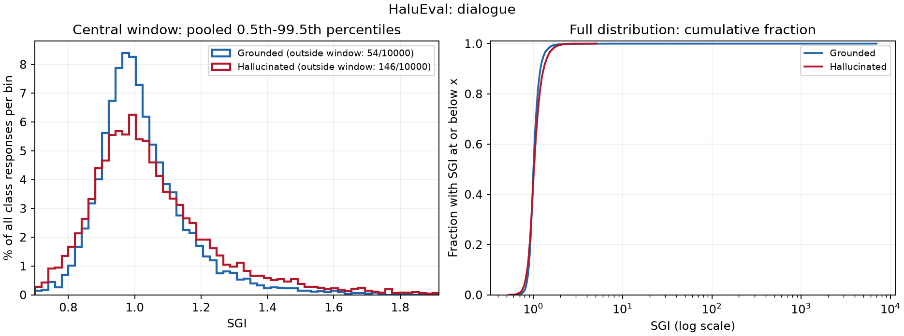
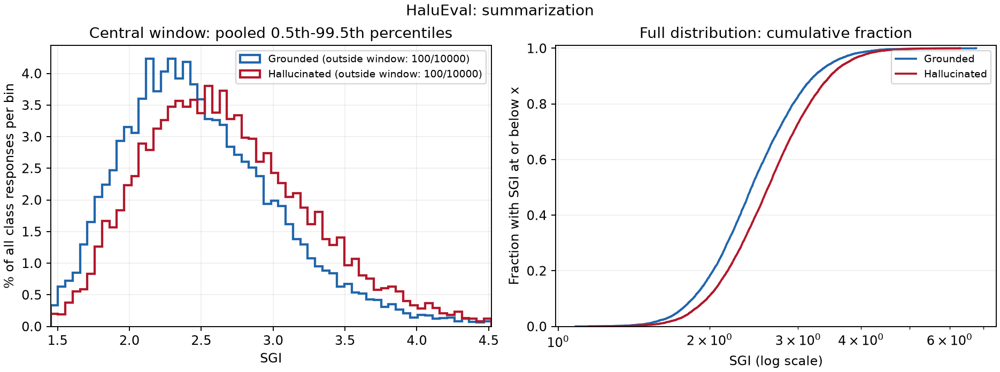
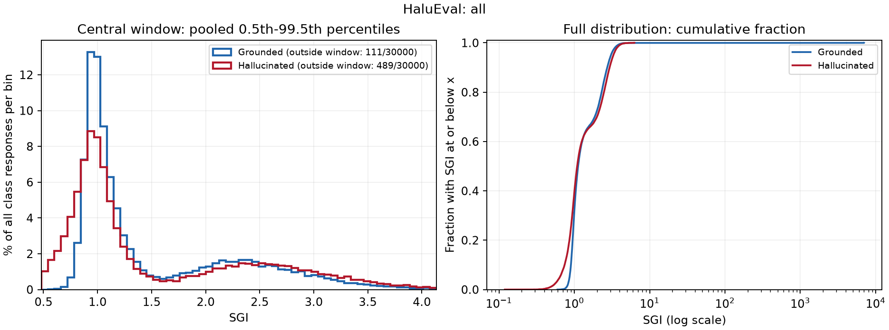

# Experiment analysis

## Research question

Can the Semantic Grounding Index distinguish reference and hallucinated responses by their position relative to a question and its supporting context? The experiments test the same angular ratio across HaluEval QA, dialogue and summarization, then examine how decision thresholds affect classification.

The project follows the geometric idea in [Marín's paper](https://arxiv.org/html/2602.13224v1), but does not fully replicate its protocol. QA is the published SGI comparison task. Dialogue uses conversation history as q; summarization uses an instruction added by this project. The separate Directional Grounding Index is not implemented.

## Experiment 1: establish the grounding signal

The recorded embedding run used all-mpnet-base-v2, masked mean pooling, L2 normalization and a 384-token limit. Each task contributes 10,000 source pairs, each containing a reference response and a hallucinated response. Labels are 0 for reference and 1 for hallucinated. General queries are excluded because they lack context.

The table is recomputed from saved per-response scores. AUROC uses -SGI, so the assumed direction is lower SGI for hallucinations.

| Task | Response rows | Mean SGI: grounded | Mean SGI: hallucinated | Cohen's d | AUROC (-SGI) |
| --- | ---: | ---: | ---: | ---: | ---: |
| qa | 20,000 | 1.066184 | 0.885615 | 0.805753 | 0.739861 |
| dialogue | 20,000 | 2.142929 | 1.057075 | 0.018896 | 0.474465 |
| summarization | 20,000 | 2.500901 | 2.683187 | -0.313486 | 0.408410 |
| all | 60,000 | 1.903338 | 1.541959 | 0.010889 | 0.539721 |

For QA, the paper reports AUROC 0.776 and Cohen's d 0.92 for the same encoder name. The recorded baseline in this repository supports the direction of the effect but does not match those values. Differences in sample selection, long-context handling and denominator stabilization remain candidates to test. No cause has been established, and no confidence interval for the discrepancy is available.

## Distribution analysis

This step describes SGI before investigating individual examples or denominator angles. All statistics use finite scores and binary labels. Standard deviations use the sample definition (ddof=1); quantiles use linear interpolation. No scores are removed to make the distributions look cleaner.

| Task | Class | N | Mean | Median | Sample SD | p95 | p99 | Maximum |
| --- | --- | ---: | ---: | ---: | ---: | ---: | ---: | ---: |
| qa | grounded | 10,000 | 1.066184 | 1.020223 | 0.194983 | 1.422007 | 1.644092 | 5.186504 |
| qa | hallucinated | 10,000 | 0.885615 | 0.866197 | 0.249845 | 1.320250 | 1.623760 | 3.197216 |
| dialogue | grounded | 10,000 | 2.142929 | 1.000685 | 81.267614 | 1.297989 | 1.596165 | 7018.469095 |
| dialogue | hallucinated | 10,000 | 1.057075 | 1.015293 | 0.213779 | 1.449624 | 1.812471 | 5.079202 |
| summarization | grounded | 10,000 | 2.500901 | 2.423287 | 0.562360 | 3.520466 | 4.163432 | 6.777159 |
| summarization | hallucinated | 10,000 | 2.683187 | 2.616506 | 0.599990 | 3.766283 | 4.351428 | 6.299610 |
| all | grounded | 30,000 | 1.903338 | 1.122376 | 46.923535 | 3.063492 | 3.733735 | 7018.469095 |
| all | hallucinated | 30,000 | 1.541959 | 1.090852 | 0.901193 | 3.295836 | 3.958904 | 6.299610 |

### What the distributions show

**QA:** the reference median is 1.020223, compared with 0.866197 for hallucinations. The middle 50% ranges are [0.929842, 1.167510] and [0.719989, 1.018237]. These intervals describe spread, not confidence limits. Their overlap shows why a single cutoff still makes errors.

**Dialogue:** the reference mean is 2.142929, but its median is 1.000685. The reference maximum is 7018.469095 and sample SD is 81.267614, compared with 5.079202 and 0.213779 for hallucinations. The hallucination median is 1.015293. The mean and median orders disagree in the recorded data. The reference distribution has a long upper tail; its mean is not a good description of a typical response. This helps interpret the small standardized mean difference, but does not identify why those extreme ratios occur. Inspecting their denominator angles remains a separate next step.

**Summarization:** reference and hallucination medians are 2.423287 and 2.616506. Their middle 50% ranges are [2.106034, 2.824938] and [2.250637, 3.040001]. In the recorded run, both the means and medians put hallucinated summaries higher. The reversed direction therefore also appears in the central values; it is not merely a difference between the two maxima. This step does not isolate the effects of the fixed instruction, context truncation or response style.

**Pooled scores:** task-specific locations differ substantially. The pooled distribution mixes these locations and should not replace the separate task comparisons.

### Distribution figures

The left panel shows a shared within-task window from the pooled 0.5th to 99.5th percentile. Each histogram bin is a percentage of all usable responses in that class; the legend counts values outside the displayed window. The right panel shows the complete empirical cumulative distribution, including extremes, on a log score axis. A cumulative value of 0.8 at x means 80% of that class has SGI at most x. Neither display changes the data or metrics.

[Full class statistics](results/HaluEval/distributions/sgi_distributions.csv) include minimum, p01, p05, p25, median, p75, p95, p99, p99.9, maximum and interquartile range. [Plot window counts](results/HaluEval/distributions/plot_windows.csv) make visual clipping explicit. [Distribution settings](results/HaluEval/distributions/distribution_config.json) record the source-score hash and plotting choices.

## Experiment 2: compare fixed cutoffs

Predict hallucination when SGI < threshold; equality is grounded. The current grid spans 0.70 to 1.40 in steps of 0.05. The earlier 1.00-2.00 sweep is retained in the parent results folder. Accuracy changes use 1.00 as the reference.

| SGI threshold | QA accuracy | Dialogue accuracy | Summarization accuracy | All accuracy |
| ---: | ---: | ---: | ---: | ---: |
| 0.70 | 61.18% | 50.30% | 50.00% | 53.83% |
| 0.75 | 64.53% | 50.62% | 50.00% | 55.05% |
| 0.80 | 67.83% | 51.39% | 50.00% | 56.41% |
| 0.85 | 70.56% | 52.05% | 50.00% | 57.54% |
| 0.90 | 70.17% | 52.49% | 50.00% | 57.55% |
| 0.95 | 66.73% | 50.75% | 50.00% | 55.83% |
| 1.00 | 63.77% | 47.94% | 50.00% | 53.90% |
| 1.05 | 60.98% | 46.41% | 50.00% | 52.47% |
| 1.10 | 59.16% | 45.70% | 49.99% | 51.62% |
| 1.15 | 57.53% | 45.85% | 49.98% | 51.12% |
| 1.20 | 55.81% | 46.35% | 49.98% | 50.71% |
| 1.25 | 54.20% | 46.87% | 49.96% | 50.34% |
| 1.30 | 53.10% | 47.30% | 49.94% | 50.11% |
| 1.35 | 52.04% | 47.80% | 49.94% | 49.93% |
| 1.40 | 51.30% | 48.21% | 49.90% | 49.80% |

These are descriptive measurements on the available labeled examples. The highest accuracy in the grid is an observation on these data, not a validated threshold. Where several thresholds tie, the comparison below lists the first. Changing the cutoff does not change AUROC for a fixed score direction.

## Experiment 3: test a threshold derived from class means

For each task, midpoint = (mean grounded SGI + mean hallucinated SGI) / 2. It is evaluated at full precision, even outside the fixed grid. The pooled estimate is a separate summary and does not replace task-specific thresholds.

| Task | Mean SGI: grounded | Mean SGI: hallucinated | Midpoint | Accuracy: SGI < midpoint | Mean-based rule | Accuracy: mean-based rule |
| --- | ---: | ---: | ---: | ---: | --- | ---: |
| qa | 1.066184 | 0.885615 | 0.975899 | 65.08% | SGI < midpoint | 65.08% |
| dialogue | 2.142929 | 1.057075 | 1.600002 | 49.20% | SGI < midpoint | 49.20% |
| summarization | 2.500901 | 2.683187 | 2.592044 | 43.34% | SGI > midpoint | 56.66% |
| all | 1.903338 | 1.541959 | 1.722648 | 49.43% | SGI < midpoint | 49.43% |

The fixed-below policy preserves the original rule. The mean-based diagnostic uses SGI > midpoint when the hallucinated mean is higher; otherwise it is identical to the below rule. Equality is grounded in both policies. Direction changes are explicit and do not alter the baseline AUROC reported above.

A midpoint is a heuristic, not an optimum. It ignores distribution shape, extreme ratios, class priors and error costs. Both the midpoint and the diagnostic direction are estimated on the same labeled data used for evaluation. Any improvement needs confirmation on separate test pairs.

## Comparison of the tested approaches

| Task | Accuracy at 1.00 | Highest accuracy in this grid | Grid threshold | Midpoint | Accuracy at midpoint (below rule) |
| --- | ---: | ---: | ---: | ---: | ---: |
| qa | 63.77% | 70.56% | 0.85 | 0.975899 | 65.08% |
| dialogue | 47.94% | 52.49% | 0.90 | 1.600002 | 49.20% |
| summarization | 50.00% | 50.00% | 0.70 | 2.592044 | 43.34% |
| all | 53.90% | 57.55% | 0.90 | 1.722648 | 49.43% |

## Findings from the recorded HaluEval experiment

**QA:** In this grid, accuracy reaches 70.565% at 0.85, compared with 63.765% at 1.00. The midpoint gives 65.08%. This compares a geometric boundary with empirical cutoffs; it does not establish an independently optimal threshold.

**Dialogue:** The highest grid accuracy is 52.485% at 0.90. The midpoint gives 49.20%, with recall 97.44% and false positive rate 99.04%. A high recall with frequent false alarms does not establish a useful detector. Inspect dispersion and denominator angles before relying on class means.

**Summarization:** At threshold 1.00, all responses are accepted as grounded. Reference accuracy is 50.00% and hallucination recall is 0.00%. The midpoint is 2.592044. It yields 43.34% under the below rule and 56.66% under the mean-based diagnostic. This does not establish a cause for the task difference or transfer to new examples. The constant instruction is an exploratory adaptation, not a question supplied by HaluEval.

**Pooled scores:** Combining tasks hides their different score distributions. Report task-specific results before drawing conclusions from the pooled value. The individual source pairs are also dependent observations: both responses must remain together in any split or bootstrap.

The tables and decision comparisons above are computed from the supplied scores. The encoder settings and literature comparison refer to the recorded HaluEval experiment; document any change to that provenance when evaluating other inputs.

## Next experiments

- [x] Establish the per-task SGI baseline and compare QA with the paper.
- [x] Evaluate both threshold grids and verify the overlapping results.
- [x] Evaluate class-mean midpoint thresholds with explicit directions.
- [x] Compare accuracy, recall and false alarms for the tested approaches.
- [x] Describe SGI quantiles and dispersion and plot per-task distributions.
- [ ] Inspect small response-context angles and individual extreme cases.
- [ ] Test whether context truncation changes the QA result.
- [ ] Compare SGI against response-context similarity on the same pairs.
- [ ] Test alternative summarization instructions using development pairs.
- [ ] Select thresholds and directions on development pairs, then evaluate once on separate test pairs.
- [ ] Add bootstrap confidence intervals grouped by pair_id.

## Evidence and reproducibility

[Baseline exports](results/HaluEval/sgi_metrics.csv), [embedding configuration](results/HaluEval/run_config.json) and [threshold configuration](results/HaluEval/thresholds_0.70_1.40/threshold_sweep_config.json) record the data revision, preprocessing and source-score hash. [Grid metrics](results/HaluEval/thresholds_0.70_1.40/threshold_metrics.csv) and [midpoint metrics](results/HaluEval/thresholds_0.70_1.40/midpoint_metrics.csv) retain full-precision values and confusion counts. Package versions are recorded for reproducibility. The embedding model revision was not pinned in the initial run.

Accuracy values in CSV are fractions; Markdown tables show percentages. Nonfinite scores and nonbinary labels are excluded and counted. Undefined ratios are NaN. No embeddings were recomputed for threshold evaluation. This file is the single narrative report; result directories contain numerical exports and run metadata.
